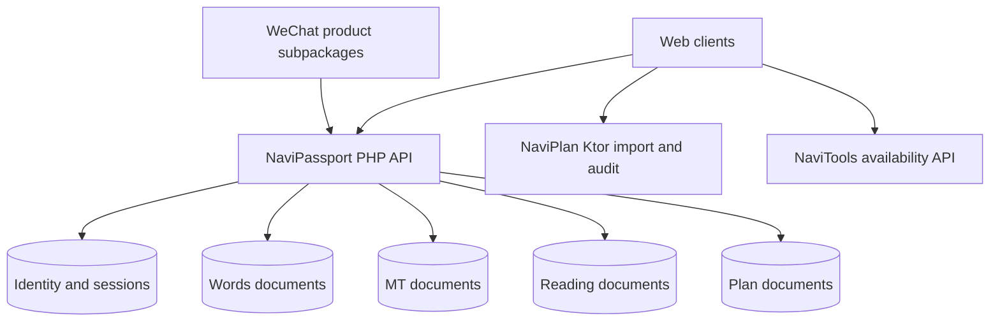

# Architecture

The clients persist practice state locally. Passport authenticates users and validates product scopes before accepting synchronization mutations. A shared account does not imply shared product data.

`apps/study-platform/src/AuthService.php` implements authentication, session refresh and authorization. `SyncService.php` handles per-product documents and mutations. `AdminService.php` and `AnalyticsService.php` provide authenticated administration and aggregate usage information.

`packages/words-mini/miniprogram/utils/store.js` contains learning-state persistence. `pages/practice` restores sessions and handles card/choice/spelling interaction. Product modules are assembled into `apps/wechat/miniprogram` by `npm run sync:wechat`.

NaviPlan separates upstream parsing, degree models and audit calculations under `apps/plan/backend/src/main/kotlin`. The React front end and mini-program consume these models. UBAA adaptation code retains its upstream license.

The public export omits production deployment automation. Configure your own origins before connecting the clients to a self-hosted service. NaviOJ is an external link with independent identity.
